# Architecture — WombTo18 8-Hour MVP

## One application, two ABDM roles

Use one React frontend and one Express backend. The backend contains both:
- **HIP module:** owns the local records and responds to valid health-information requests.
- **HIU module:** initiates consent requests and receives health information.

HIP and HIU are workflow roles. They are not separate deployments. Enable only the role(s) configured for the assigned sandbox.

```mermaid
flowchart TB
  U[WombTo18 Staff] --> UI[React UI]
  UI --> API[Single Express Backend]
  API --> APP[Mother / Child / Pregnancy / Encounters]
  API --> M1[M1 ABHA]
  API --> M2[M2 Records / Care Context]
  API --> M3[M3 Consent + HIU/HIP]
  API --> M4[M4 HFR/HPR Lookup]
  M1 --> ABDM[Shared ABDM Client]
  M2 --> ABDM
  M3 --> ABDM
  M4 --> ABDM
  ABDM <--> GW[ABDM Sandbox]
  GW --> CB[Public Callback Router]
  CB --> TX[Persist Event / Deduplicate / Process]
  API --> DB[(PostgreSQL)]
  TX --> DB
```



## Required shared components

### 1. ABDM client
One server-side module handles:
- Request ID generation (UUID) where required.
- Timestamp and CM-ID headers where required.
- Authentication/token handling.
- Timeout and safe retry policy.
- Correlation ID for every internal operation.
- Redacted request/response metadata.

**Verify every header and its exact format against the current API contract.** Do not blindly attach the same headers to every API if the specification differs.

### 2. Callback router
- Expose only the callback routes required by enabled workflows.
- Use a public HTTPS URL (ngrok or equivalent only if permitted by sandbox).
- Validate exact documented headers and payload.
- Persist callback event durably before acknowledging when the callback contract permits.
- Return the exact required status/body. Do not assume universal HTTP 202.
- Process event asynchronously or immediately after persistence.
- Deduplicate and correlate with the originating transaction.

### 3. Transaction tracking
Suggested internal status lifecycle:

`INITIATED -> ACCEPTED -> WAITING_FOR_CALLBACK -> COMPLETED`

Alternative outcomes: `FAILED`, `EXPIRED`, `REJECTED`.

These are internal labels, not ABDM status values. Store external status separately. A 200/202 response to an outbound request is not proof that the business workflow completed. Only the matching callback or documented status response should advance the workflow to its final state.

### 4. Idempotency
- Unique internal `request_id`.
- Store external `transaction_id` when returned.
- Store callback event ID if the contract provides one.
- If no callback ID exists, use a carefully selected deduplication fingerprint based on documented fields.
- Never assume `REQUEST-ID` uniquely identifies every callback event.

### 5. Audit and logging
Audit: actor, action, resource, facility, time, outcome, correlation ID.
Redact Aadhaar, ABHA identifiers, OTP, tokens, client secrets, private keys, and clinical data. Do not log raw FHIR bundles.

### 6. FHIR
Create only one minimal example for the chosen WombTo18 use case (for example, a relevant patient/encounter/observation representation). Validate against the exact ABDM/NRCeS profile and version required by the workflow. Generic FHIR validity is not sufficient.

## Minimal module layout

```text
server/src/
  app.js
  server.js
  modules/
    auth/
    patients/
    pregnancy/
    encounters/
    abha/
    health-records/
    care-contexts/
    consent/
    hip/
    hiu/
    registries/
    transactions/
  integrations/abdm/
    client.js
    auth.js
    callbacks/
    fhir/
  shared/
    errors/
    validation/
    logging/
  prisma/
```

Keep routes/controllers/services simple. Do not create microservices or a generic workflow engine.

## HIP and HIU boundary

- HIP must verify the incoming request and the applicable consent artefact/scope before releasing records.
- HIU must not request or accept records outside the granted consent scope.
- Use the documented ABDM encryption/decryption and transfer sequence; do not implement an assumed cryptographic protocol from memory.
- If full transfer is too large for the 8-hour scope, demonstrate the state machine and mock the transfer with fixture data, visibly labelled `MOCKED`.

## Security baseline

- Secrets remain server-side.
- Use synthetic records.
- No OTP/token/Aadhaar/ABHA/private-key values in logs.
- Facility-level access checks on patient records.
- Limit persisted callback data to the minimum required; redact or protect sensitive content.
