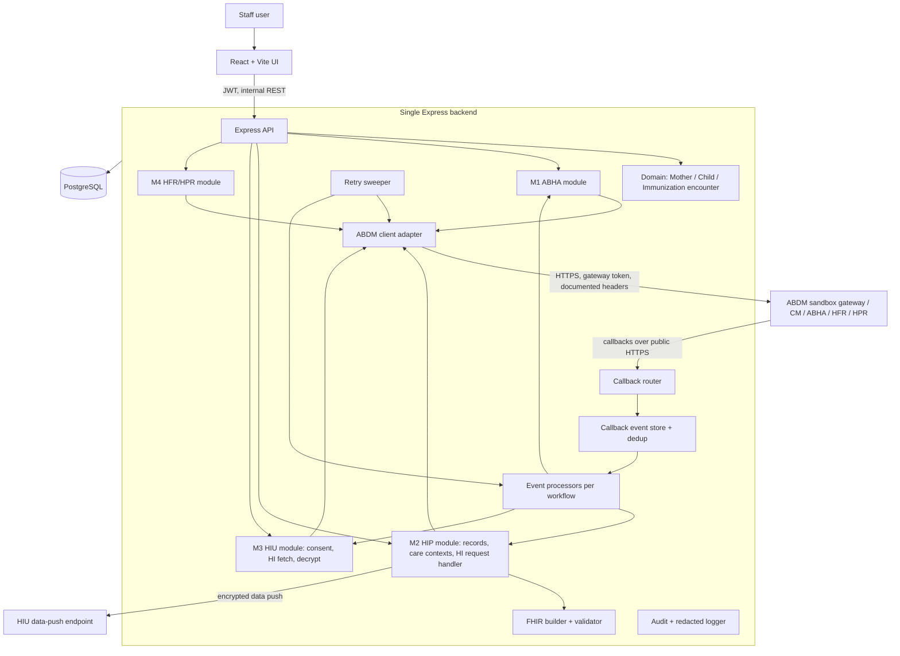
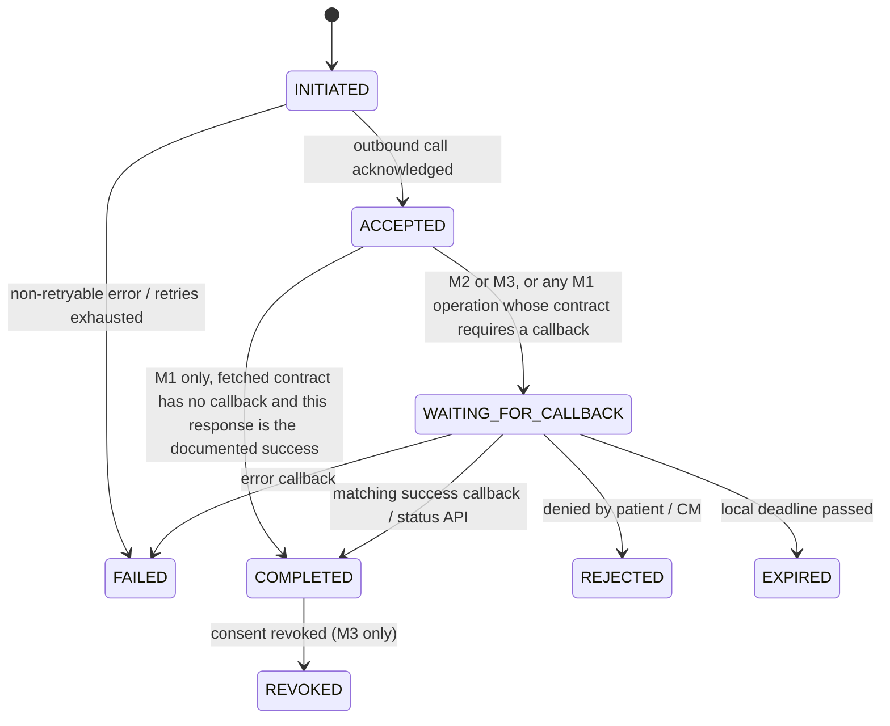
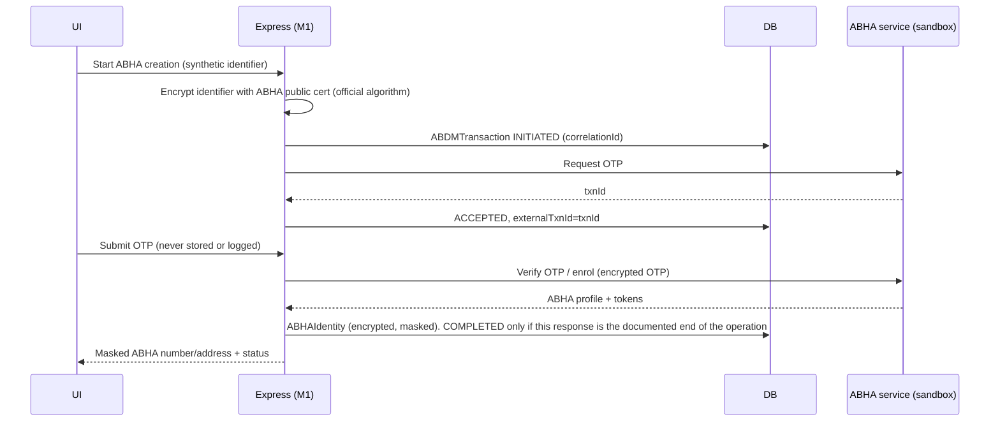
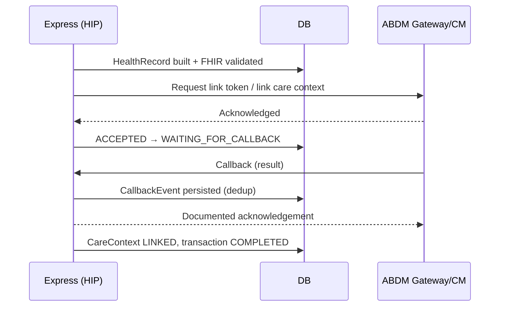
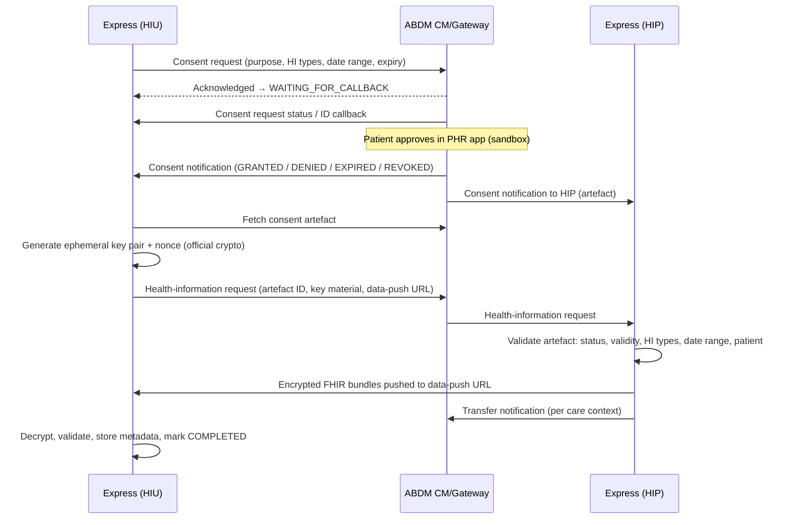

# Architecture — WombTo18 ABDM Prototype

## 1. One application, two ABDM roles

One React frontend and one Express backend. The backend contains:

- **HIP module (M2):** owns local records, links care contexts, answers health-information requests, encrypts and pushes data, and notifies transfer status.
- **HIU module (M3):** raises consent requests, receives consent notifications, fetches consent artefacts, requests health information, and receives and decrypts data.

HIP and HIU are workflow roles inside one deployment. Each is enabled only if the sandbox client is configured for that role. The two modules never call each other directly; all exchange goes through the ABDM gateway and consent manager, exactly as it would between two different organisations.

## 2. Component view



## 3. Shared components

### 3.1 ABDM client adapter (`integrations/abdm/client.js`)
- **Gateway session token:** fetched with client credentials, cached in memory until shortly before expiry, refreshed once on 401, never persisted or logged.
- **Headers:** built per API from a contract map (e.g. request ID, timestamp, CM ID, HIP/HIU ID). Every header and format is verified via MCP. Different APIs can need different headers.
- **Correlation:** each internal operation gets a `correlationId`. It goes into logs, `ABDMTransaction` and the audit log.
- **Timeouts:** explicit per call.
- **Retry policy:**

| Condition | Retry? |
|---|---|
| Network error or timeout before any response, on an idempotent or safely replayable call (same request ID) | Yes, exponential backoff with jitter, max 3 |
| HTTP 429 / 502 / 503 / 504 | Yes, respecting `Retry-After` |
| HTTP 400 / 401 (after one token refresh) / 403 / 404 / 422 | No. Mark `FAILED` and store the safe error code |
| Any OTP-consuming or one-time operation | No automatic retry |

- **Logging:** method, path template, status, latency, correlationId. Never bodies with identifiers.

### 3.2 Callback router (`integrations/abdm/callbacks/`)
For each callback route:
1. Verify the caller according to the documented callback authentication. Do not invent a signature scheme.
2. Validate headers and body with a Zod schema derived from the doc page.
3. Compute `dedupKey` (documented unique ID if one exists, otherwise a SHA-256 fingerprint of documented stable fields) and insert `CallbackEvent` with unique `(route, dedupKey)`. The same ABDM id on the HIP route and the HIU route is two events. A unique-constraint hit on that pair means a duplicate: acknowledge again and do not process again.
4. Return the documented acknowledgement (status code and body as specified).
5. Process: match the transaction via the documented correlation field, apply the allowed state transition, write the audit record.
6. If processing fails, set `processingStatus = RETRY` with `nextAttemptAt`. The sweeper reprocesses it. After the maximum number of attempts, set `DEAD` and surface it in the transaction monitor.

### 3.3 Transaction state machine
Internal labels only. The external ABDM status is stored separately in `externalStatus`.



Rules:
- M2 and M3: an HTTP 2xx moves the transaction to `ACCEPTED`, then `WAITING_FOR_CALLBACK`. It does not move it to `COMPLETED`.
- M1: if the fetched operation returns the ABHA result in that response and defines no callback, `ACCEPTED` may move to `COMPLETED` on that body. If the fetched operation requires a callback, M1 uses the M2/M3 path. Which of the OTP calls is which is `UNVERIFIED` until that page is fetched.
- A late success after `EXPIRED` is stored on the callback row and reconciled. It does not reopen a terminal transaction, and it is not discarded.
- `callbackDeadlineAt` is set only when the workflow is waiting for a callback. A local expiry is not proof that ABDM failed.

### 3.4 Idempotency
- `ABDMTransaction.requestId` is unique. A retry of the same logical operation reuses the same request ID where the API permits it.
- `CallbackEvent` is unique on `(route, dedupKey)`.
- Internal state-changing POST routes accept `Idempotency-Key`. A repeat returns the original response.
- `REQUEST-ID` is not assumed to identify a callback event uniquely unless the contract says so.

### 3.5 Audit and logging
- `AuditLog` row for every state-changing action and every ABDM exchange: actor, facility, action, resource type and ID, outcome, correlationId, timestamp. It is append-only and the application has no update or delete path.
- Pino `redact` paths cover the identifier, OTP, token and payload fields (`docs/security.md`).

### 3.6 FHIR
- Profile names and the NRCeS IG package id are `UNVERIFIED`. Do not hard-code `OPConsultRecord`, `WellnessRecord`, or `ImmunizationRecord` until the FHIR skill or MCP page names them.
- Core stores `hiType` only after that page is fetched. Full HL7 validator runs are Extension. A bundle that fails a check that has been verified is never linked or shared. The result is stored on `HealthRecord`.
- Raw bundles are not logged. They are generated on demand from the source records for sharing, so no plaintext clinical temp files are written.

## 4. Sequence diagrams

Message names below are descriptive. Exact API paths and payloads come from the ABDM v3 docs (MCP).

### 4.1 M1 — ABHA creation (OTP-based)



`COMPLETED` on the verify response is allowed only when the fetched M1 page defines no further callback. Paths, cipher, and padding are `UNVERIFIED`. Encrypt the ABHA number with its dashes kept, as the Build with AI page requires. The certificate URL is `UNVERIFIED`.

### 4.2 M2 — Care-context linking (HIP-initiated example)



### 4.3 M3 — Consent and health information exchange



## 5. HIP/HIU boundary rules
- HIP releases data only for a consent artefact that it received from the CM and stored, which is `GRANTED`, unexpired, unrevoked, and covers the requested HI types, date range and care contexts.
- HIU rejects or ignores pushed data that doesn't match an active health-information request it initiated.
- Revocation or expiry immediately blocks further HIP releases. In-flight requests are rejected.
- If real encrypted transfer is not possible in the sandbox, the transfer step is `MOCKED` with visible labelling. Consent enforcement stays real either way.

## 6. Module layout

```text
server/src/
  app.js / server.js
  config/                 # env loading + validation (fails fast), sandbox-only guard
  modules/
    auth/ patients/ encounters/
    abha/                 # M1
    health-records/ care-contexts/ hip/        # M2
    consent/ hiu/                              # M3
    registries/                                # M4 (HFR, HPR)
    transactions/ audit/
  integrations/abdm/
    client.js  auth.js  headers.js  retry.js
    crypto/              # official-sample based only
    callbacks/           # router, schemas, processors
    fhir/                # builders, validator wrapper
  jobs/sweeper.js        # retries, callback deadlines, consent expiry
  shared/ errors/ validation/ logging/
prisma/schema.prisma
client/                  # React + Vite modular monolith
  src/app/               # routes, providers, ErrorBoundary
  src/modules/           # auth, patients, abha, audit (api / hooks / pages / validation)
  src/shared/            # Axios http client, TanStack Query, UI primitives, styles
```

The React client is a modular monolith aligned with backend domains. Feature modules own their API clients, React Query hooks, Zod form schemas, and pages. Shared Axios unwraps `{ success, data }`, maps `ApiError`, and clears session on 401. TanStack Query holds server state; auth session uses `['auth','me']`. Custom CSS tokens live in `shared/styles`. This is a structure and client-hardening change only (`IMPLEMENTED_NOT_SANDBOX_TESTED`).

## Facility / bridge / role configuration

One bridge serves every facility. Client credentials and the callback base URL are environment settings, not facility columns, and not a per-facility settings screen. That rule is from the ABDM Build with AI page (24 Oct 2026). Do not add bridge association tables in Core.

`ABDM_HIP_ID` and `ABDM_HIU_ID` may be set once for this sandbox client. Whether those ids are actually per facility is `UNVERIFIED`. A `Facility` row may store an HFR id returned or supplied for the demo. M4 lookup does not create that id.

Keep these URL responsibilities distinct:
- **Callback ingress base URL:** where ABDM callbacks are received.
- **HIU data-push URL:** the destination/configuration used for health-information delivery to the HIU.

They may route to the same Express deployment, but they are not interchangeable configuration values.

## Callback persistence and reconciliation

Callback processing must preserve the information needed by asynchronous workers. Validate and normalize first, persist the minimum required fields, deduplicate, acknowledge exactly as the specific callback contract requires, and then process at the documented stage. Do not assume every callback contains a globally unique event ID or uses the same acknowledgement.

A local timeout/expiry is not proof that ABDM failed. Persist late callbacks and reconcile them against documented remote status. Do not blindly reopen a terminal local transaction, but do not discard the late event either. Retain the event history and record the reconciliation outcome.

## Delivery semantics

Do not claim exactly-once delivery across the local database and external ABDM systems. Aim for effectively-once business processing with durable callback inbox records, unique constraints, idempotent handlers, transactional state changes and reconciliation for ambiguous outcomes.
